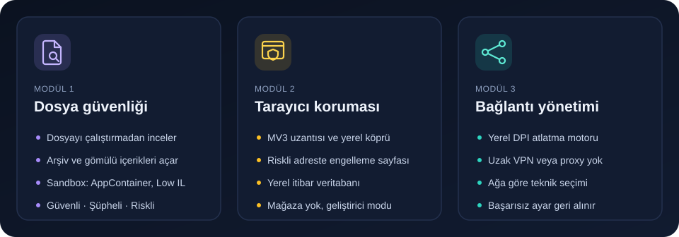
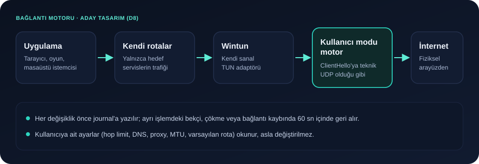
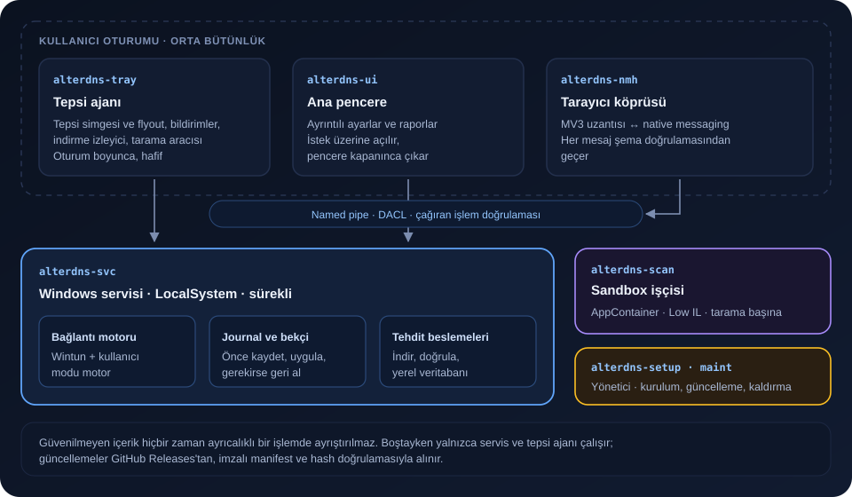
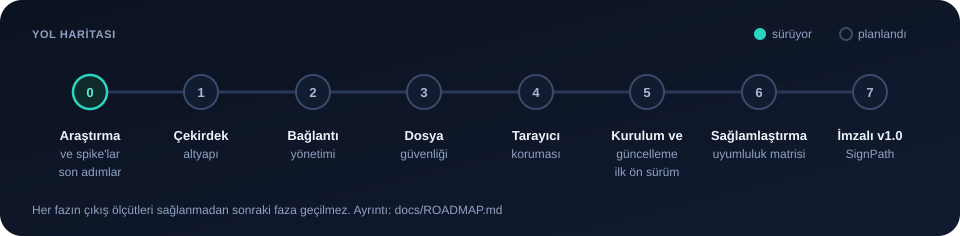

<p align="center">
  
</p>

<h1 align="center">AlterDNS</h1>

<p align="center">
  <strong>Windows için modüler, yerel çalışan güvenlik ve bağlantı uygulaması</strong><br>
  Dosyaları çalıştırmadan inceler · Riskli sitelerden önce uyarır · Engellenen servislere uzak sunucu olmadan erişim sağlar
</p>

<p align="center">
  <a href="https://github.com/fxrkqnplus/alterdns/actions/workflows/ci.yml"></a>
  
  
  
</p>

> [!IMPORTANT]
> AlterDNS **ön geliştirme aşamasındadır** (Faz 0: araştırma ve doğrulama). Henüz indirilebilir bir sürüm yoktur. Bu sayfadaki işlevler, tasarımı ve ölçümleri tamamlanmış hedeflerdir; her biri ilgili fazda geliştirilip test edilecektir.

## İçindekiler

- [Neden AlterDNS?](#neden-alterdns)
- [Modüller](#modüller)
- [Bağlantı motoru nasıl çalışır?](#bağlantı-motoru-nasıl-çalışır)
- [Tasarım ilkeleri](#tasarım-ilkeleri)
- [Mimari](#mimari)
- [Güvenlik ve güven zinciri](#güvenlik-ve-güven-zinciri)
- [Gizlilik](#gizlilik)
- [Sistem gereksinimleri](#sistem-gereksinimleri)
- [Yol haritası](#yol-haritası)
- [Kaynaktan derleme](#kaynaktan-derleme)
- [Depo yapısı](#depo-yapısı)
- [İndirme ve doğrulama](#indirme-ve-doğrulama)
- [Katkı ve güvenlik bildirimi](#katkı-ve-güvenlik-bildirimi)
- [Lisans](#lisans)
- [English summary](#english-summary)

## Neden AlterDNS?

Sık karşılaşılan üç ihtiyaç genellikle birbirinden bağımsız araçlarla karşılanıyor. Bu araçların bazıları antivirüsü kapatmayı, bazıları ise trafiği bilinmeyen bir uzak sunucudan geçirmeyi istiyor:

- İndirilen bir dosyanın, içindeki arşiv ve belgelerle birlikte **açmadan** güvenli olup olmadığını anlamak,
- Kimlik avı ve zararlı yazılım dağıtan adreslere **girmeden önce** uyarılmak,
- Ağ düzeyinde engellenen servislere, trafiği bir VPN'e devretmeden **kendi bağlantınızla** ulaşmak.

AlterDNS bu üç işi tek, modüler bir uygulamada, bilgisayarınızda yerel olarak yapar. Her modül ayrı bir bileşendir; yalnızca istediğinizi kurarsınız. Uygulama sistem tepsisinden yönetilir ve antivirüsünüzle birlikte çalışır, onun yerini almaz.

## Modüller

<p align="center">
  
</p>

### Dosya güvenliği

İndirilen dosyaları ve gömülü içeriklerini **çalıştırmadan** inceler.

- **Korumalı inceleme:** Ayrıştırma, yetkisiz bir sandbox işçisinde yapılır (AppContainer, Low IL, Job Object). Güvenilmeyen içerik hiçbir zaman ayrıcalıklı bir işlemde işlenmez.
- **İç içe içerik:** Arşivler (zip, 7z, tar ailesi, cab, iso…), Office belgeleri, PDF akışları ve e-posta dosyaları açılarak her katman ayrı ayrı incelenir.
- **Analiz:** Tür tespiti, yapısal analizörler ve YARA-X kuralları. Windows Defender yüklü ve etkinse ondan da görüş alınır. Çevrim içi hash itibarı yalnızca kullanıcı onayıyla sorgulanır.
- **Sonuç:** `Güvenli`, `Şüpheli` veya `Riskli`. İncelenemeyen kısımlar (ör. parola korumalı arşiv) ayrıca belirtilir; sessizce "güvenli" sayılmaz.
- **Eylemler:** Karantina ve silme işlemleri sonradan doğrulanır.

### Tarayıcı koruması

Riskli adreslere girilmeden **önce** AlterDNS engelleme sayfasını gösterir.

- **Bileşenler:** Bir MV3 tarayıcı uzantısı ve uygulamayla konuşan bir native messaging köprüsü. Köprüden geçen her mesaj şema doğrulamasından geçer.
- **Yerel itibar veritabanı:** Tehdit beslemeleri serviste indirilir, doğrulanır ve sıkıştırılmış bir veritabanına dönüştürülür. Adres sorguları milisaniyenin altında, yerelde yanıtlanır.
- **Dağıtım:** Uzantı mağazada yayımlanmaz. Uygulama klasöründen, tarayıcının geliştirici moduyla yüklenir; uygulama bunun için adım adım bir sihirbaz sunar.

### Bağlantı yönetimi

Ağ düzeyinde **derin paket incelemesiyle (DPI)** engellenen servislere, uzak bir VPN veya proxy sunucusu kullanmadan erişim sağlar.

- **Yerel motor:** Trafik bu bilgisayarda işlenir. Kimlik bilgileriniz, gezinme geçmişiniz ve trafiğiniz üçüncü bir sunucuya gitmez.
- **Ağa göre uyum:** Motor bulunduğunuz ağda kısa, zaman sınırlı denemelerle çalışan tekniği seçer ve sonucu o ağ için hatırlar.
- **Güvenli geri dönüş:** Başarısız bir ayar otomatik olarak geri alınır. Uygulama çökse bile ayrı bir bekçi işlem yaptığı değişiklikleri kısa sürede kaldırır.
- **Kapsam:** Yalnızca hedef servislerin trafiği motordan geçer; diğer bütün trafik her zamanki gibi akar.

## Bağlantı motoru nasıl çalışır?

<p align="center">
  
</p>

1. AlterDNS kendi sanal ağ adaptörünü (Wintun TUN) ve **yalnızca hedef servisler için** kendi rotalarını ekler. Varsayılan rotanıza ve diğer ayarlarınıza dokunmaz.
2. Bu servislere giden bağlantılar kullanıcı modunda çalışan motora ulaşır. Motor bağlantıyı gerçek hedefe fiziksel arayüzünüz üzerinden yeniden kurar.
3. TLS el sıkışmasının ilk mesajına (ClientHello) sürücü gerektirmeyen bir teknik uygulanır (ör. bant dışı veriyle bölme). Bu, DPI'ın alan adına bakarak bağlantıyı kesmesini önler.
4. UDP trafiği (ses, oyun) olduğu gibi aktarılır.

**Faz 0 bulguları** (tek bir mobil ağda ölçüldü; ayrıntı: [`docs/research/CONNECTIVITY_RESEARCH.md`](docs/research/CONNECTIVITY_RESEARCH.md)):

| Soru | Sonuç |
|---|---|
| Engel nasıl uygulanıyor? | Alan adına (SNI) bakılarak TLS bağlantısı sıfırlanıyor. Farklı DNS çözümleyicileri aynı yanıtı verdi; engel DNS'te değil. |
| Hangi teknik en geniş uyumlu? | Bant dışı veriyle bölme (`Oob@SNI`): problarda ve gerçek istemcilerin hepsinde çalıştı. |
| Hop limit (TTL) değeri önemli mi? | Hayır. Teknikler 64, 65 ve Windows varsayılanı olan 128'de aynı sonucu verdi. |
| Ses ve oyun trafiği engelleniyor mu? | Hayır. UDP trafiğine teknik uygulamadan sesli sohbet ve çok oyunculu oyun çalıştı. |
| Gerçek uygulamalar çalıştı mı? | Evet. Masaüstü ve web istemcileri, sesli sohbet ve oyun dahil, motor üzerinden çalıştı. |

> [!NOTE]
> Motor teknolojisi (Wintun + kullanıcı modu motor) **koşullu olarak kabul edildi**. Kesinleşmesi, ön derlenmiş Wintun bileşeninin kod imzalama programıyla uyumunun teyidine bağlıdır. Bkz. [`docs/DECISIONS.md`](docs/DECISIONS.md) ADR-003.

## Tasarım ilkeleri

- **Kullanıcının ayarlarına dokunmaz.** Hop limit, DNS, DoH, proxy, MTU, varsayılan rota ve güvenlik duvarı gibi değerler yalnızca okunur, geçici olarak bile değiştirilmez. Uygulama mevcut değerlere uyum sağlar ve yalnızca kendi oluşturduğu nesneleri ekleyip kaldırır.
- **Her sistem değişikliği kayıtlıdır.** Değişiklik önce bir journal'a yazılır, sonra uygulanır. Ayrı işlemdeki bekçi, uygulama çökse ya da bağlantı kopsa bile değişikliği geri alır.
- **En az ayrıcalık.** Yalnızca servis, journal ve güncelleme uygulaması yönetici yetkisiyle çalışır. Güvenilmeyen içerik yetkisiz sandbox'ta ayrıştırılır.
- **Hafif.** Boştayken yalnızca servis ve küçük tepsi ajanı çalışır. Ana pencere ve tarama işçisi ihtiyaç anında başlar, iş bitince çıkar. Yoklama yerine Windows bildirimleri kullanılır.
- **Modüler.** Her modül ayrı bir bileşen paketidir. Kurulu olmayan modülün kodu diskte bulunmaz.
- **Antivirüsle uyumlu.** AlterDNS antivirüsü veya Smart App Control'ü kapatmanızı, istisna eklemenizi asla istemez.

## Mimari

<p align="center">
  
</p>

| İşlem | Bağlam | Görev |
|---|---|---|
| `alterdns-svc` | Windows servisi, LocalSystem | Bağlantı motoru, journal, tehdit beslemeleri |
| `alterdns-tray` | Kullanıcı oturumu | Tepsi simgesi ve flyout, bildirimler, indirme izleyici, tarama aracısı |
| `alterdns-ui` | Kullanıcı, isteğe bağlı | Ana pencere |
| `alterdns-scan` | AppContainer, Low IL, tarama başına | Dosya ayrıştırma ve analiz |
| `alterdns-nmh` | Tarayıcının başlattığı işlem | Uzantı ile servis arasındaki köprü |
| `alterdns-setup`, `alterdns-maint` | Yönetici (UAC) | Kurulum, bileşen değiştirme, güncelleme, kaldırma |

Ayrıntılar: [`docs/ARCHITECTURE.md`](docs/ARCHITECTURE.md) · Kararlar: [`docs/DECISIONS.md`](docs/DECISIONS.md) · Arayüz: [`docs/UI_SPEC.md`](docs/UI_SPEC.md)

## Güvenlik ve güven zinciri

- **Kod imzalama (planlanan):** Yalnızca ücretsiz yollar kullanılacak. Hedef, açık kaynak projelere imza sağlayan SignPath Foundation programıdır. Buna ek olarak her sürüm GitHub Artifact Attestations ve Ed25519 imzalı bir manifestle yayımlanacak.
- **Güncellemeler (planlanan):** Yalnızca bu deponun Releases sayfasından alınacak. İndirilen bileşenler uygulanmadan önce imzalı manifest ve hash ile doğrulanacak.
- **Tedarik zinciri:**
  - Bağımlılık lisansları ve güvenlik duyuruları `cargo-deny` ile denetlenir.
  - GitHub Actions adımları tam commit SHA'sıyla sabitlenir; iş akışı izinleri salt okunurdur.
  - Gizli bilgi taraması ve push sırasında engelleme açıktır; kod CodeQL ile taranır.
- **Depo hijyeni:** Her değişiklik öncesinde `cargo xtask check` biçim, lint, test, lisans ve kişisel veri/gizli bilgi taramasını birlikte çalıştırır.
- **Tehdit modeli:** [`docs/SECURITY.md`](docs/SECURITY.md)

## Gizlilik

- **Telemetri yoktur.**
- Dosya incelemesi, adres sorguları ve bağlantı motoru bilgisayarınızda çalışır.
- Çevrim içi bir sorgu (ör. hash itibarı) yalnızca açık onayınızla yapılır.
- Loglar boyutu sınırlı tutulur ve kişisel veri içermeyecek şekilde azaltılır.

## Sistem gereksinimleri

| | Hedef |
|---|---|
| İşletim sistemi | Windows 10 22H2, Windows 11 23H2 ve sonrası |
| Mimari | x64 (ARM64 desteklenmez; kurulum açık bir hata koduyla durur) |
| Yetki | Kurulum ve bağlantı motoru için yönetici onayı |
| Güvenlik özellikleri | Bellek bütünlüğü (HVCI), Defender ve Smart App Control açıkken test edilecek |

Uyumluluk matrisi (Windows sürümleri, ağ türleri, başka VPN ve DPI araçları): [`docs/TESTING.md`](docs/TESTING.md) §6.

## Yol haritası

<p align="center">
  
</p>

| Faz | Kapsam | Durum |
|---|---|---|
| 0 | Ortam, depo güvenliği, spike'lar, bağlantı araştırması | Son adımlar |
| 1 | Çekirdek altyapı: hata kataloğu, IPC, journal ve bekçi, servis, tepsi ajanı ve ana pencere kabuğu | Planlandı |
| 2 | Bağlantı yönetimi | Planlandı |
| 3 | Dosya güvenliği | Planlandı |
| 4 | Tarayıcı koruması | Planlandı |
| 5 | Kurulum, bileşen yöneticisi, güncelleme, kaldırma; ilk ön sürüm | Planlandı |
| 6 | Sağlamlaştırma, uyumluluk matrisi, kod imzalama başvurusu | Planlandı |
| 7 | İmzalı v1.0 | Planlandı |

Her fazın çıktıları, testleri ve çıkış ölçütleri: [`docs/ROADMAP.md`](docs/ROADMAP.md).

## Kaynaktan derleme

**Gereksinimler**

- Rust stable, MSVC hedefi (`rust-toolchain.toml` sürümü sabitler)
- Visual Studio Build Tools: MSVC derleyicisi ve Windows SDK
- Git

**Doğrulama**

```powershell
git clone https://github.com/fxrkqnplus/alterdns.git
cd alterdns
cargo xtask check
```

`cargo xtask check` sırasıyla şunları çalıştırır:
- `rustfmt` ve `clippy -D warnings`;
- testler;
- `cargo-deny` (lisans ve güvenlik duyuruları);
- telif başlığı, kişisel veri ve gizli bilgi taraması.

**Bağlantı araştırma düzeneği**

`cargo xtask lab` ölçüm senaryolarını çalıştırır. Sistem değiştiren senaryolar yalnızca açık onayla, journal ve bekçi korumasıyla, zaman sınırlı çalışır. Kullanım ve kurtarma adımları: [`lab/RUNBOOK.md`](lab/RUNBOOK.md).

## Depo yapısı

```
alterdns/
├─ xtask/            Geliştirme komutları (check) ve bağlantı araştırma düzeneği (lab)
├─ lab/              Lab kılavuzu, salt okunur betikler, sabitlenmiş bileşen sürümleri
├─ spikes/           Faz 0 teknik denemeleri: sandbox, arayüz, Wintun
├─ data/             Ölçüm hedefleri (problar, gerçek istemci testi)
├─ docs/             Mimari, kararlar, yol haritası, test, güvenlik, arayüz, araştırma
├─ assets/           Marka ve README görselleri
├─ CONTRIBUTING.md   Geliştirme kuralları
├─ LICENSE           GPL-3.0-or-later ve Wintun ek izni
└─ TRADEMARK.md      Ad ve logo kullanımı
```

## İndirme ve doğrulama

Resmi sürümler yalnızca bu deponun [Releases](https://github.com/fxrkqnplus/alterdns/releases) sayfasında yayımlanacaktır. Bir dosyanın bu deponun derleme hattında üretildiğini şöyle doğrulayabilirsiniz:

```powershell
gh attestation verify <dosya> -R fxrkqnplus/alterdns
```

Her sürümde ayrıca bir `SHA256SUMS` dosyası bulunur.

> [!WARNING]
> AlterDNS hiçbir zaman antivirüsünüzü veya Windows Akıllı Uygulama Denetimi'ni kapatmanızı istemez. Bunu isteyen bir yönerge, site veya kopya sahtedir.

**Kod imzalama durumu:** İlk ön sürümler kod imzası taşımayacak; Windows SmartScreen uyarı gösterebilir. Proje SignPath Foundation programına başvuracak. İmza alındığında bu bölüme programın öngördüğü ifade ("Free code signing provided by SignPath.io, certificate by SignPath Foundation") ve rol listesi (Yazar / İnceleyen / Onaylayan) eklenecek.

## Katkı ve güvenlik bildirimi

- **Katkı:** Geliştirme kuralları, değişmez ilkeler ve kod standartları [`CONTRIBUTING.md`](CONTRIBUTING.md) dosyasındadır. Katkılar GPL-3.0-or-later ve `LICENSE` sonundaki ek izinle kabul edilir.
- **Güvenlik açığı bildirimi:** Açıkları herkese açık issue olarak değil, deponun **Security → Report a vulnerability** bölümünden özel olarak bildirin.

## Lisans

Copyright © 2026 Furkan Okan

AlterDNS özgür yazılımdır: **GNU General Public License v3.0 veya (seçiminize göre) daha sonraki bir sürümün** koşulları altında yeniden dağıtabilir ve/veya değiştirebilirsiniz. Ayrıntılar için [`LICENSE`](LICENSE) dosyasına bakın. Bu program faydalı olması umuduyla dağıtılmaktadır, ancak HİÇBİR GARANTİ VERİLMEMEKTEDİR.

**Ek izin (GPL-3.0 §7):** `LICENSE` dosyasının sonunda, AlterDNS kodunun Wintun projesinin dağıttığı değiştirilmemiş, imzalı `wintun.dll` ile birleştirilmesine izin veren bir ek izin bulunur. Ek izin yalnızca AlterDNS telif sahibinin (ve bu izni kabul eden katkıcıların) kodunu kapsar.

"AlterDNS" adı ve logosu bu lisansın kapsamı dışındadır; bkz. [`TRADEMARK.md`](TRADEMARK.md). Üçüncü taraf bileşenler kendi lisanslarına tabidir; bkz. [`docs/research/THIRD_PARTY.md`](docs/research/THIRD_PARTY.md).

## English summary

AlterDNS is a modular, local-first security and connectivity application for Windows (GPL-3.0-or-later). It is in **pre-development**; no release is available yet. It has three modules:

- **File security:** inspects downloads and their nested content without executing them, in an AppContainer sandbox.
- **Browser protection:** shows a block page before risky sites, using an MV3 extension and a local reputation database.
- **Connection management:** a local DPI-circumvention engine (Wintun TUN + user-mode engine) that never routes traffic through a remote server.

It never modifies user-owned system settings such as the hop limit, DNS or proxy. Every system change it makes to its own objects is journaled and reverted by a separate watchdog. Security issues should be reported privately via **Security → Report a vulnerability**.
